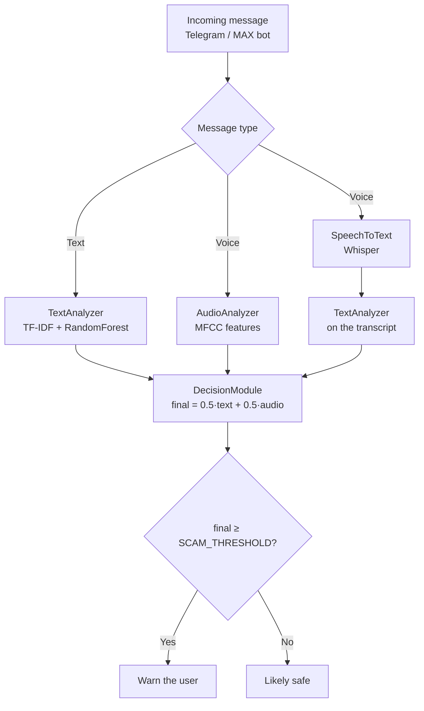

<div align="center">

# ScamShield

**Development of an intelligent system for detecting scam messages and calls in messengers**

ScamShield is a multimodal, ML-powered assistant bot for **Telegram** and **MAX** that analyzes
incoming text and voice messages in real time and warns the user about possible fraud.

[](https://www.python.org/)
[](https://scikit-learn.org/)
[](https://github.com/openai/whisper)
[](https://core.telegram.org/bots/api)
[](https://dev.max.ru/)
[](https://librosa.org/)

**English** · [Русский](README.ru.md)

</div>

---

## Table of Contents

- [Introduction](#-introduction)
- [Domain Analysis](#-domain-analysis)
- [System Architecture](#-system-architecture)
- [Models & Data](#-models--data)
- [Supported Scenarios](#-supported-scenarios)
- [Evaluation & Results](#-evaluation--results)
- [Economic Impact](#-economic-impact)
- [Quick Start](#-quick-start)
- [Known Issue: MAX Voice Messages](#-known-issue-max-voice-messages)
- [Project Structure](#-project-structure)
- [References](#-references)

---

## Introduction

As digital communication rapidly moves into messengers, user security has become a pressing concern. According to statistics, the number of cybercrimes involving messengers keeps growing: attackers use phishing links, psychological pressure and even synthesized voice messages to steal money and personal data.

**Why it matters.** There is a real need for intelligent tools capable of analyzing incoming messages in real time and warning the user before any damage is done.

**Goal** — build a software system that automatically analyzes text and voice messages in messengers and detects signs of fraud using machine learning.

**Objectives:**

1. Review existing scam-detection methods and identify their strengths and weaknesses.
2. Assemble and prepare a training dataset of text and voice messages.
3. Build a text analysis model using vectorization (TF-IDF) and machine learning algorithms.
4. Build an audio analysis model based on acoustic features (MFCC).
5. Integrate automatic speech-to-text transcription for unified analysis.
6. Combine text and audio analysis into a single multimodal decision engine.
7. Implement bots for Telegram and MAX to interact with users and process messages in real time.
8. Test the system experimentally and evaluate its effectiveness.

**Research novelty** lies in the multimodal approach that combines text analysis (message content), voice acoustics (intonation, stress) and speech transcription.

**Practical value.** The system ships as messenger bots, which makes it available to a wide audience without installing any additional software.

**Methods:** review of scientific and technical literature, machine learning methods (TF-IDF, random forest, MFCC), experimental testing, economic analysis.

---

## Domain Analysis

**Common scam patterns in messengers:**

| Pattern | Description |
|---|---|
| **Phishing** | Messages with links to fake websites imitating messenger login pages, banking services or government portals |
| **Fake "tech support"** | Messages posing as support agents demanding a confirmation code |
| **Social engineering (text)** | Urgent requests for financial help from a "hacked" friend's account |
| **Voice message fraud** | Calls and voice messages where the attacker poses as a bank or law-enforcement officer and demands a transfer to a "safe account" |

**Comparison of existing detection methods:**

| Method | Drawbacks |
|---|---|
| Static (blocklists of numbers, URLs, keywords) | Low adaptability to new schemes |
| Rule-based text analysis | Hard to maintain; bypassed by rephrasing |
| Classical ML (Naive Bayes, SVM, Logistic Regression) | Require quality datasets, but scale well |
| Modern NLP (BERT, GPT) | High accuracy, but high compute cost |
| Voice analysis (MFCC) | Detects stress and unnatural speech |

**Takeaway:** the most promising direction is a multimodal approach that combines text analysis, voice acoustics and speech transcription.

---

## System Architecture

The system consists of six key modules:

1. **Message intake (Telegram & MAX bots)** — interacts with users, accepts text and voice messages in real time: in private chats with the bot, in group chats (opted in by an administrator) and in personal chats via the Telegram Business connection.
2. **Preprocessing module** — for text: cleaning, lowercasing, stop-word removal; for audio: conversion to a standard format (WAV, mono, 16 kHz) using `librosa`.
3. **TextAnalyzer** — vectorizes text with `TfidfVectorizer` (scikit-learn) and a `RandomForest` classifier that returns the scam probability.
4. **AudioAnalyzer** — extracts MFCC features (Mel-frequency cepstral coefficients) and a scikit-learn classifier (the `audio_model.pkl` model) estimates the likelihood of fraud from voice acoustics.
5. **SpeechToText** — the pre-trained **Whisper** model (OpenAI) transcribes voice messages, and the transcript is passed to TextAnalyzer for content analysis. Works in the Telegram bot; temporarily unavailable in the MAX bot due to a server-side MAX Bot API bug (see [Known Issue](#-known-issue-max-voice-messages)).
6. **DecisionModule** — fuses the `score_text` and `score_audio` scores with a weighted rule (e.g. `final_score = 0.5·score_text + 0.5·score_audio`) and issues the final verdict.



On top of the ML models, a rule-based booster compares the message against reference scam/safe templates (`SequenceMatcher`), which improves robustness on short and unusual texts.

**Message processing pipeline:**

1. The user sends a text or voice message to the bot.
2. The handler (`bot_handler`) detects the content type.
3. If it is text, it goes to `TextAnalyzer`, which returns the `score_text` score.
4. If it is audio, two branches run in parallel: `AudioAnalyzer` extracts MFCC features and returns `score_audio`, while `SpeechToText` transcribes the audio and sends the transcript to `TextAnalyzer` (the `score_stt` score).
5. All scores are passed to `DecisionModule`, which issues the final verdict based on the weighted rule.
6. The user receives the result.

---

## Models & Data

**Text dataset** — 2,000+ messages collected from open sources, forums and public chats, labeled into two classes: scam and safe.

**Audio dataset** — 100+ voice recordings: real scam call examples as well as synthesized recordings imitating typical scenarios.

Training is implemented in the `src/training` modules:

* `train_text.py` — trains the text classifier (TF-IDF + RandomForest);
* `train_audio.py` — trains the audio classifier on MFCC-based features.

| | Text model | Audio model |
|---|---|---|
| **Input** | Message text | Voice message (WAV, mono, 16 kHz) |
| **Features** | TF-IDF vectors | 13 MFCC means + spectral centroid + zero-crossing rate |
| **Classifier** | RandomForest (scikit-learn) | StandardScaler + RandomForest |
| **Artifacts** | `models/text_model.pkl`, `models/text_vectorizer.pkl` | `models/audio_model.pkl` |

---

## Supported Scenarios

| Scenario | Telegram | MAX |
|---|:---:|:---:|
| Check a message in a private chat with the bot | Yes | Yes |
| Check voice messages | Yes | No* |
| Forwarded messages (text / voice) | Yes | Yes (text only) |
| Screen group chats | Yes | Yes |
| Screen a personal chat with another person | Yes | No |

\* Voice messages in MAX are temporarily unavailable due to a server-side MAX Bot API bug — see [Known Issue](#-known-issue-max-voice-messages).

---

## Evaluation & Results

Testing was performed on a held-out data split (10% of the full dataset) that was not used in training. As hypothesized, the multimodal approach demonstrated the highest effectiveness: combining text analysis, acoustic analysis and transcription makes it possible to detect scam messages that go unnoticed by text-only analysis.

Key conclusions:

* **Hypothesis confirmed.** The multimodal approach combining text analysis, voice acoustics and speech transcription proved more effective than text-only analysis.
* **Both models trained and evaluated.** The text and audio classifiers showed high scores on the held-out split.
* **Working prototype built.** The bots implement the full processing cycle: from message intake to the final verdict and a user warning.
* **Practical and economic value proven.** The system is able to prevent real financial losses of users and businesses.

---

## Economic Impact

**Target audience:** individuals (messenger users concerned about digital safety), small and medium businesses (companies communicating with customers via messengers), and crypto enthusiasts and investors (the most frequent targets of fraudsters).

**Development cost.** The project was developed independently using free, open-source tools, so the MVP development cost was **0 ₽**.

**Prevented damage.** According to Kaspersky reports, the average damage from one successful scam attack is about 15,000 ₽. For an audience of 10,000 users, even conservative estimates put the prevented damage far above the development cost: it can reach 900 attacks × 15,000 ₽ = **13,500,000 ₽**. Even under a pessimistic forecast, the system pays back the development cost many times over.

---

## Quick Start

### 1. Clone & install

```bash
git clone https://github.com/your-username/ScamShield.git
cd ScamShield
python -m venv venv
source venv/bin/activate      # Linux / macOS
venv\Scripts\activate         # Windows
pip install -r requirements.txt
```

### 2. Configure

Create a `.env` file in the project root:

```ini
telegram_bot_token=YOUR_TELEGRAM_BOT_TOKEN   # token from @BotFather (Telegram)
max_bot_token=YOUR_MAX_BOT_TOKEN             # token from dev.max.ru (MAX)
SCAM_THRESHOLD=0.6                           # risk threshold (optional)
```

### 3. Prepare data & train models

Text templates live in `data/scam_calls/scam.txt` (scam) and `data/scam_calls/not_scam.txt` (safe) — one message per line; voice recordings go to `data/real` and `data/fake`:

```text
data/
├── scam_calls/
│   ├── scam.txt        # scam message examples
│   └── not_scam.txt    # safe message examples
├── real/               # legitimate voice samples (WAV)
└── fake/               # fraudulent voice samples (WAV)
```

Training:

```bash
python -m src.training.train_text    # text model (TF-IDF + RandomForest)
python -m src.training.train_audio   # audio model (MFCC)
```

### 4. Run the bots

```bash
python -m src.bot.telegram_bot      # Telegram bot (text + voice)
python -m src.bot.max_bot           # MAX bot (long polling, text only)
```

---

## Known Issue: MAX Voice Messages

Since July 2026, the MAX Bot API has a **server-side bug**: "native" voice messages sent from app versions **26.17.x and newer** (iOS and Android) are not serialized by the API. The bot receives a `message_created` update **without the `message` field** (only `timestamp`, `user_locale`, `update_type`), and the voice message is **missing even from `GET /messages`** — it cannot be retrieved via polling or repeated requests. Text and images are not affected. The key factor is the **sender's app version**, not the bot settings: with app version **26.10.1**, voice messages arrive fully intact (with URL and transcription).

For the sake of completeness, the decision was made to wait for an API update from the MAX developers.

Trackers confirming the issue:

- `max-messenger/max-bot-api-client-ts` — issue **#250** ("A native voice message creates an empty message_created without a message and is missing from GET /messages");
- `love-apples/maxapi` — issue **#191** (label `upstream`).

Because of this bug, the MAX bot currently works **with text messages only**: voice messages are neither accepted nor analyzed until the bug is fixed on the MAX side. Text messages (including forwarded ones) reach the bot normally.

---

## Project Structure

```
ScamShield/
├── data/
│   ├── fake/                  # fraudulent voice samples (WAV)
│   ├── real/                  # legitimate voice samples (WAV)
│   └── scam_calls/            # text templates: scam.txt / not_scam.txt
├── src/
│   ├── bot/
│   │   ├── telegram_bot.py    # Telegram bot: private chats, groups, business
│   │   └── max_bot.py         # MAX bot: private chats, groups, text only
│   ├── common/
│   │   ├── model_utils.py     # DecisionModule: score fusion
│   │   ├── audio_features.py  # MFCC feature extraction
│   │   └── voice_utils.py     # Whisper speech-to-text
│   ├── prediction/            # predict_text / predict_audio / predict_full
│   └── training/              # train_text / train_audio
└── requirements.txt
```

---

## References

<details>
<summary>Click to expand</summary>

1. Goodfellow, I., Bengio, Y., Courville, A. *Deep Learning*. — MIT Press, 2016.
2. Russell, S., Norvig, P. *Artificial Intelligence: A Modern Approach*. — 4th ed., Pearson, 2021.
3. Bishop, C. M. *Pattern Recognition and Machine Learning*. — Springer, 2006. — 738 p.
4. Devlin, J. et al. (2018). *BERT: Pre-training of Deep Bidirectional Transformers for Language Understanding*.
5. Radford, A. et al. (2022). *Robust Speech Recognition via Large-Scale Weak Supervision* (Whisper).
6. [scikit-learn documentation](https://scikit-learn.org/)
7. [librosa documentation](https://librosa.org/doc/latest/index.html)
8. Kaspersky cyberthreat reports, 2024–2025.
9. Group-IB research on fraud in messengers.

</details>

---

<div align="center">

**ScamShield** — keeping your chats safe

</div>