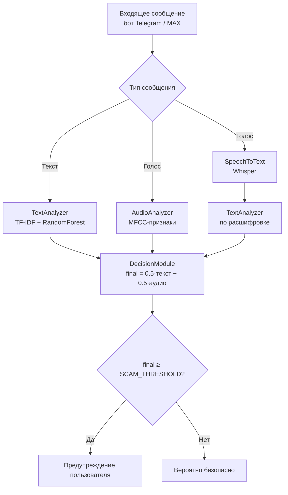

<div align="center">

# ScamShield

**«Разработка интеллектуальной системы обнаружения мошеннических сообщений и звонков в мессенджере Telegram»**

Научно-исследовательская работа

[](https://www.python.org/)
[](https://scikit-learn.org/)
[](https://github.com/openai/whisper)
[](https://core.telegram.org/bots/api)
[](https://dev.max.ru/)
[](https://librosa.org/)

[English](README.md) · **Русский**

</div>

---

## Содержание

- [I. Введение](#i-введение)
- [II. Основная часть](#ii-основная-часть)
  - [Гипотеза](#гипотеза)
  - [1. Анализ предметной области](#1-анализ-предметной-области)
  - [2. Архитектура системы](#2-архитектура-системы)
  - [3. Данные и обучение моделей](#3-данные-и-обучение-моделей)
  - [4. Программная реализация](#4-программная-реализация)
  - [5. Экспериментальное тестирование](#5-экспериментальное-тестирование)
- [III. Экономическая эффективность проекта](#iii-экономическая-эффективность-проекта)
- [IV. Вывод](#iv-вывод)
- [V. Заключение](#v-заключение)
- [VI. Список используемой литературы](#vi-список-используемой-литературы)
- [Практическое использование](#практическое-использование)
- [Известная проблема MAX](#известная-проблема-max)

---

## I. Введение

В эпоху стремительного развития цифровых технологий и перехода значительной части коммуникаций в онлайн-среду вопрос безопасности пользователей мессенджеров становится особенно острым. Согласно статистике, количество киберпреступлений, связанных с использованием мессенджеров, неуклонно растет: злоумышленники используют фишинговые ссылки, психологическое давление и даже синтезированные голосовые сообщения для хищения денежных средств и персональных данных.

**Актуальность** работы обусловлена необходимостью создания интеллектуальных инструментов, способных в реальном времени анализировать входящие сообщения и предупреждать пользователя о возможной угрозе.

**Цель** — разработка программной системы, способной автоматически анализировать текстовые и голосовые сообщения в мессенджерах и выявлять признаки мошенничества с использованием методов машинного обучения.

**Задачи:**

1. Провести анализ существующих методов обнаружения мошеннических сообщений и определить их преимущества и недостатки.
2. Сформировать и подготовить обучающий набор данных, включающий текстовые и голосовые сообщения.
3. Разработать модель для анализа текстовых сообщений с использованием методов векторизации (TF-IDF) и алгоритмов машинного обучения.
4. Разработать модель для анализа аудиосообщений на основе извлечения акустических признаков (MFCC).
5. Интегрировать модель автоматической транскрибации речи в текст для объединенного анализа.
6. Создать единую мультимодальную систему, объединяющую результаты текстового и аудиоанализа для вынесения итогового решения.
7. Реализовать ботов для мессенджеров Telegram и MAX для практического взаимодействия с пользователями и обработки сообщений в реальном времени.
8. Провести экспериментальное тестирование и оценить эффективность разработанной системы.

**Объект исследования** — процесс коммуникации в мессенджерах (Telegram, MAX), включающий текстовые и голосовые сообщения.

**Предмет исследования** — методы машинного обучения и обработки естественного языка (NLP) для автоматического выявления мошеннических сообщений.

**Научная новизна** заключается в применении мультимодального подхода, сочетающего анализ текста (содержание сообщения), акустический анализ голоса (интонация, стресс) и транскрибацию речи.

**Практическая значимость.** Система реализована в виде ботов для мессенджеров, что обеспечивает её доступность для широкого круга пользователей без необходимости установки дополнительного программного обеспечения.

**Методы:** анализ научной и технической литературы, методы машинного обучения (TF-IDF, случайный лес, MFCC), экспериментальное тестирование, экономический анализ.

---

## II. Основная часть

### Гипотеза

Мультимодальный подход к анализу сообщений позволит повысить точность обнаружения мошенничества по сравнению с анализом только текстового содержимого. Анализ лишь текста недостаточен для надежного выявления мошенничества, поскольку злоумышленники в голосовых сообщениях применяют психологическое давление, которое не всегда отражается в текстовой расшифровке.

### 1. Анализ предметной области

**Основные типы мошенничества в мессенджерах:**

| Тип | Описание |
|---|---|
| **Фишинг** | Сообщения со ссылками на поддельные сайты, имитирующие страницы входа в мессенджер, банковские сервисы или государственные порталы |
| **Имитация взлома аккаунта** | Сообщения от имени «технической поддержки» с требованием сообщить код подтверждения |
| **Социальная инженерия (текст)** | Просьбы о срочной финансовой помощи от лица знакомого, чей аккаунт якобы был взломан |
| **Мошенничество с голосовыми сообщениями** | Звонки и голосовые сообщения, в которых злоумышленник представляется сотрудником банка или правоохранительных органов и требует перевести средства на «безопасный счет» |

**Анализ существующих методов:**

| Метод | Недостатки |
|---|---|
| Статические (черные списки номеров, URL, ключевых слов) | Низкая адаптивность к новым схемам |
| Анализ текста на основе правил | Сложность поддержки, обходится перефразированием |
| Классические ML (Naive Bayes, SVM, Logistic Regression) | Требуют качественного датасета, но масштабируемы |
| Современные NLP (BERT, GPT) | Высокая точность, но большие затраты на вычисления |
| Анализ голоса (MFCC) | Позволяет выявлять стресс и неестественность речи |

**Вывод по анализу:** наиболее перспективным представляется мультимодальный подход, сочетающий анализ текста, акустических характеристик голоса и транскрибацию речи.

### 2. Архитектура системы

Система состоит из шести ключевых модулей:

1. **Модуль приема сообщений (боты Telegram и MAX)** — обеспечивает взаимодействие с пользователем, принимает текстовые и голосовые сообщения в реальном времени: в личном чате с ботом, в групповых чатах (по включению администратором) и в личных чатах через бизнес-подключение Telegram.
2. **Модуль предобработки данных** — для текста: очистка, приведение к нижнему регистру, удаление стоп-слов; для аудио: конвертация в стандартный формат (WAV, mono, 16 кГц) с помощью библиотеки `librosa`.
3. **Модуль анализа текста (TextAnalyzer)** — векторизация текста через `TfidfVectorizer` (scikit-learn) и классификатор на основе случайного леса (`RandomForest`), возвращающий вероятность мошенничества.
4. **Модуль анализа аудио (AudioAnalyzer)** — извлечение MFCC-признаков (Mel-frequency cepstral coefficients) и классификатор scikit-learn (модель `audio_model.pkl`), оценивающий вероятность мошенничества по акустике речи.
5. **Модуль распознавания речи (SpeechToText)** — предобученная модель **Whisper** (OpenAI) преобразует голосовые сообщения в текст, который направляется в TextAnalyzer для анализа содержимого. Работает в Telegram-боте; в MAX-боте голосовые сообщения временно недоступны из-за серверного бага MAX Bot API (см. раздел [«Известная проблема MAX»](#известная-проблема-max)).
6. **Модуль принятия решения (DecisionModule)** — объединяет оценки `score_text` и `score_audio` по взвешенному правилу (например, `final_score = 0.5*score_text + 0.5*score_audio`) и выносит итоговое решение.



### 3. Данные и обучение моделей

**Текстовый датасет** включает более 2000 сообщений, собранных из открытых источников, форумов и общедоступных чатов, размеченных на два класса: мошеннические и безопасные.

**Аудиодатасет** включает более 100 голосовых сообщений: как реальные примеры мошеннических звонков, так и синтезированные записи, имитирующие типичные сценарии.

Обучение реализовано в модулях `src/training`:

* `train_text.py` — обучение текстового классификатора (TF-IDF + RandomForest);
* `train_audio.py` — обучение аудиоклассификатора на MFCC-признаках.

Дополнительно система обогащает оценку правилами на основе похожести сообщения на эталонные шаблоны мошеннических и безопасных сообщений (SequenceMatcher), что повышает устойчивость к коротким и нетипичным текстам.

### 4. Программная реализация

Система реализована на языке **Python**. Ключевые технологии:

* **scikit-learn** — векторизация текста (TF-IDF) и классификаторы;
* **librosa** — извлечение MFCC-признаков из аудио;
* **OpenAI Whisper** — транскрибация голосовых сообщений;
* **aiohttp / aiogram-стек** — асинхронная работа с Telegram Bot API;
* **maxapi** — работа с Bot API мессенджера MAX.

**Схема обработки сообщения:**

1. Пользователь отправляет текстовое или голосовое сообщение боту.
2. Обработчик (`bot_handler`) определяет тип контента.
3. Если это текст — он направляется в `TextAnalyzer`, который возвращает оценку `score_text`.
4. Если это аудио — параллельно запускаются два процесса: `AudioAnalyzer` извлекает MFCC и возвращает `score_audio`, а `SpeechToText` транскрибирует аудио в текст, который затем отправляется в `TextAnalyzer` (оценка `score_stt`).
5. Все оценки передаются в `DecisionModule`, который на основе взвешенного правила выносит итоговое решение.
6. Результат.

**Поддерживаемые сценарии:**

| Сценарий | Telegram | MAX |
|---|:---:|:---:|
| Проверка сообщения на мошенничество в личном чате с ботом | Да | Да |
| Проверка голосовых сообщений | Да | Нет* |
| Пересланные сообщения (текст/голос) | Да | Да (только текст) |
| Проверка сообщений в группах | Да | Да |
| Проверка сообщений в личном чате с человеком | Да | Нет |

\* Голосовые сообщения в MAX временно недоступны из-за серверного бага MAX Bot API (см. раздел [«Известная проблема MAX»](#известная-проблема-max) ниже).

### 5. Экспериментальное тестирование

Тестирование проведено на отложенной выборке данных (10% от общего датасета), не участвовавшей в обучении. Как и предполагалось в гипотезе, мультимодальный подход продемонстрировал наивысшую эффективность: комбинация текстового анализа, акустического анализа и транскрибации позволяет выявлять мошеннические сообщения, которые проходят незамеченными при анализе только текста.

---

## III. Экономическая эффективность проекта

**Целевая аудитория:** частные лица (пользователи мессенджеров, обеспокоенные цифровой безопасностью), малый и средний бизнес (компании, использующие мессенджеры для коммуникации с клиентами), криптоэнтузиасты и инвесторы (наиболее частые жертвы мошенников).

**Затраты на разработку.** Проект разработан самостоятельно, с использованием бесплатных инструментов и библиотек с открытым исходным кодом, поэтому стоимость разработки MVP составила 0 рублей.

**Оценка предотвращенного ущерба.** Согласно отчетам «Лаборатории Касперского», средний ущерб от одной успешной мошеннической атаки составляет порядка 15 000 рублей. При аудитории в 10 000 пользователей даже при консервативных оценках система способна предотвратить ущерб, многократно превышающий затраты на разработку: предотвращенный ущерб может достигать 900 атак × 15 000 руб. = **13 500 000 рублей**. Даже при пессимистичном прогнозе система окупает затраты на разработку многократно.

---

## IV. Вывод

В ходе выполнения научно-исследовательской работы достигнута поставленная цель — разработана программная система, способная анализировать текстовые и голосовые сообщения в мессенджерах на предмет признаков мошенничества. На основе проделанной работы можно утверждать:

* **Гипотеза подтверждена.** Мультимодальный подход, сочетающий анализ текста, акустических характеристик голоса и транскрибацию речи, продемонстрировал более высокую эффективность, чем анализ только текстового содержимого.
* **Разработаны и обучены эффективные модели** — текстовый и аудиоклассификаторы показали высокие показатели на отложенной выборке.
* **Создан действующий прототип** — боты реализуют полный цикл обработки сообщений: от приема до вынесения решения и предупреждения пользователя.
* **Доказана практическая и экономическая значимость** — система способна предотвратить финансовые потери пользователей и бизнеса.

---

## V. Заключение

В ходе работы решены все поставленные задачи: проведен анализ предметной области, сформированы датасеты, разработаны и обучены модели, создана программная система и проведено её тестирование. Разработанная интеллектуальная система **ScamShield** представляет собой законченное прикладное решение, которое может быть использовано для повышения цифровой безопасности пользователей мессенджеров.

Цифровая среда становится неотъемлемой частью нашей жизни, и создание доступных инструментов защиты — важный шаг к безопасному будущему.

---

## VI. Список используемой литературы

<details>
<summary>Развернуть список</summary>

1. Гудфеллоу, Я., Бенджио, И., Курвилль, А. Глубокое обучение. — М.: ДМК Пресс, 2018. — 652 с.
2. Рассел, С., Норвиг, П. Искусственный интеллект: современный подход. — М.: Вильямс, 2021. — 1408 с.
3. Бишоп, К. М. Pattern Recognition and Machine Learning. — Springer, 2006. — 738 p.
4. Devlin, J. et al. (2018). BERT: Pre-training of Deep Bidirectional Transformers for Language Understanding.
5. Radford, A. et al. (2022). Robust Speech Recognition via Large-Scale Weak Supervision (Whisper).
6. Документация scikit-learn: https://scikit-learn.org/
7. Документация librosa: https://librosa.org/doc/latest/index.html
8. Отчеты «Лаборатории Касперского» о киберугрозах за 2024–2025 гг.
9. Исследования «Group-IB» о мошенничестве в мессенджерах.

</details>

---

## Практическое использование

### Установка

```bash
git clone https://github.com/your-username/ScamShield.git
cd ScamShield
python -m venv venv
source venv/bin/activate        # Linux / macOS
venv\Scripts\activate           # Windows
pip install -r requirements.txt
```

### Настройка

Создайте файл `.env` в корне проекта:

```ini
telegram_bot_token=YOUR_TELEGRAM_BOT_TOKEN   # токен из BotFather (Telegram)
max_bot_token=YOUR_MAX_BOT_TOKEN             # токен из dev.max.ru (MAX)
SCAM_THRESHOLD=0.6                           # порог риска (опционально)
```

### Данные и обучение моделей

Шаблоны сообщений размещаются в `data/scam_calls/scam.txt` (мошеннические) и `data/scam_calls/not_scam.txt` (безопасные) — по одной записи на строку; голосовые записи — в `data/real` и `data/fake`:

```text
data/
├── scam_calls/
│   ├── scam.txt       # мошеннические сообщения (примеры)
│   └── not_scam.txt   # безопасные сообщения (примеры)
├── real/              # настоящие голосовые записи (WAV)
└── fake/              # мошеннические голосовые записи (WAV)
```

Обучение:

```bash
python -m src.training.train_text    # текстовая модель (TF-IDF + RandomForest)
python -m src.training.train_audio   # аудиомодель (MFCC)
```

### Запуск ботов

```bash
python -m src.bot.telegram_bot      # Telegram-бот (текст и голосовые)
python -m src.bot.max_bot           # MAX-бот (long polling, только текст)
```

### Структура проекта

```
ScamShield/
├── data/
│   ├── fake/                  # мошеннические голосовые записи (WAV)
│   ├── real/                  # настоящие голосовые записи (WAV)
│   └── scam_calls/            # текстовые шаблоны: scam.txt / not_scam.txt
├── src/
│   ├── bot/
│   │   ├── telegram_bot.py    # Telegram-бот: личный чат, группы, business
│   │   └── max_bot.py         # MAX-бот: личный чат, группы, только текст
│   ├── common/
│   │   ├── model_utils.py     # DecisionModule: объединение оценок
│   │   ├── audio_features.py  # извлечение MFCC
│   │   └── voice_utils.py     # транскрибация через Whisper
│   ├── prediction/            # predict_text / predict_audio / predict_full
│   └── training/              # train_text / train_audio
└── requirements.txt
```

---

## Известная проблема MAX: голосовые не доходят до бота (баг #250)

С июля 2026 года в MAX Bot API есть **серверный баг**: «нативные» голосовые,
отправленные из приложений версии **26.17.x и новее** (iOS и Android), не
сериализуются API. Бот при этом получает обновление `message_created` **без поля
`message`** (только `timestamp`, `user_locale`, `update_type`), а само голосовое
**отсутствует даже в `GET /messages`** — получить его нечем ни в режиме polling,
ни через повторные запросы. От текста и картинок это не зависит — они доходят
нормально. Ключевой фактор — **версия приложения отправителя**, а не настройки
бота: с приложением **26.10.1** голосовые приходят полностью (с URL и
транскрипцией).

Для полноты проекта было решено дождаться обновления API от разработчиков MAX.

Подтверждения и трекеры:

- `max-messenger/max-bot-api-client-ts` — issue **#250** («Нативное голосовое
  создаёт пустой message_created без message и отсутствует в GET /messages»);
- `love-apples/maxapi` — issue **#191** (метка `upstream`).

Из-за этого бага MAX-бот работает **только с текстовыми сообщениями**:
голосовые не принимаются и не анализируются, пока баг не исправлен на стороне
MAX. Текстовые сообщения (в том числе пересланные) доходят до бота нормально.